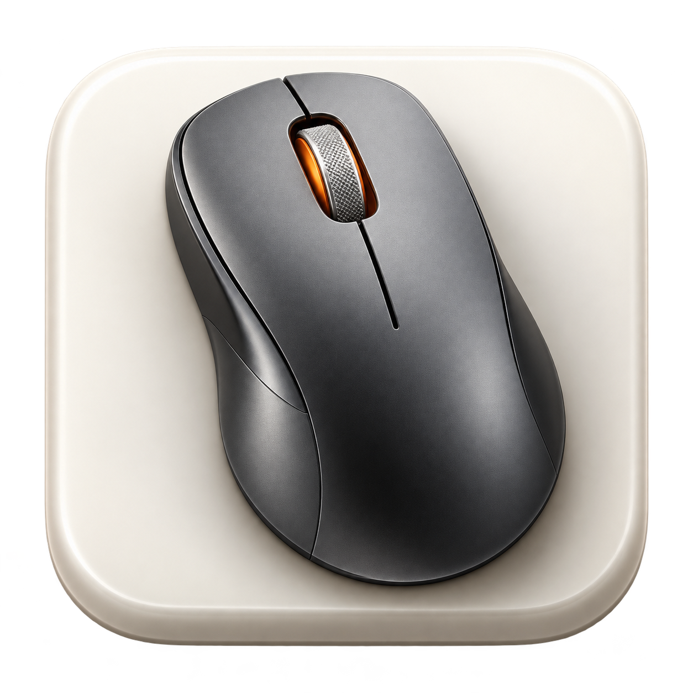
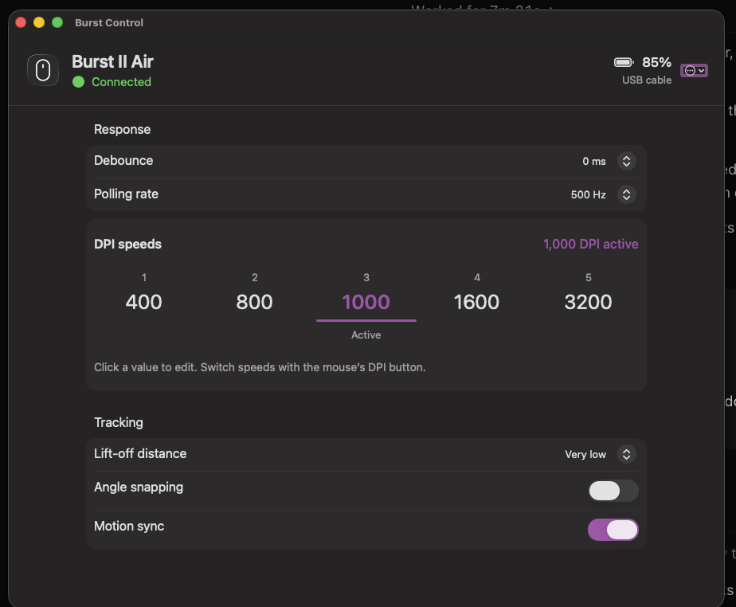

<div align="center">
  
  <h1>Burst Control</h1>
  <p>A native macOS companion for the Turtle Beach Burst II Air.</p>
  <p>Adjust your mouse directly over USB. No Windows PC or virtual machine required.</p>
  <p>
    <a href="https://github.com/artyomkulimov/burstcontrol/actions/workflows/checks.yml"></a>
    
    <a href="LICENSE"></a>
  </p>
</div>



## What you can do

- Set **debounce from 0 to 10 ms**.
- Edit all **five DPI stages**, from 50 to 26,000 DPI in steps of 50.
- See the active DPI stage as you switch with the mouse’s physical DPI button.
- Choose **125, 250, 500, or 1,000 Hz** polling.
- Adjust lift-off distance, angle snapping, and motion sync.
- View the reported **battery percentage**, charging indicator, and connection type.
- Connect through the **2.4 GHz receiver or USB cable**; cable takes priority when both are present.

The app detects USB connections automatically. Changes stay in a draft until you
click **Apply**, with a backup before writing and a read-back check afterward.
Unsaved edits survive disconnects; external settings changes are handled explicitly.

## Download

[Download Burst Control for Apple silicon](https://github.com/artyomkulimov/burstcontrol/releases/latest)
(macOS 13 or later). The app is Developer ID signed and notarized by Apple.

Download the `.zip` from the release assets, extract it, and move **Burst Control**
to Applications. Open it and grant Input Monitoring as described below. The
release includes a SHA-256 checksum. Intel builds are not available yet.

## Install from source

You need **macOS 13 or later** and **Apple’s Command Line Tools**. The native app
uses SwiftUI and IOKit, with no third-party runtime dependencies. Python is not
required.

If you do not have the developer tools, run `xcode-select --install` and finish
Apple’s installation dialog first. Then:

```sh
git clone https://github.com/artyomkulimov/burstcontrol.git
cd burstcontrol
./build-app.sh
./install-app.sh
open "$HOME/Applications/Burst Control.app"
```

Quit an existing copy before running the installer. The build script creates
`dist/Burst Control.app`; the installer copies it to `~/Applications`.
These are locally built, ad-hoc-signed apps, not notarized releases.

### Allow access to the mouse

On first launch, enable **Burst Control** under **System Settings → Privacy &
Security → Input Monitoring**, then quit and reopen the app.

The configuration report shares a composite HID interface with mouse input, so
macOS requires this permission to open it. Burst Control does not intercept
movement, record keystrokes, or synthesize input.

<details>
<summary>Permission is enabled, but the app still says it needs access</summary>

A rebuild changes the app’s ad-hoc signature. macOS can retain permission for the
old signature even when the toggle appears enabled.

1. Quit Burst Control.
2. Remove its old entry from **Input Monitoring** using the minus button.
3. Add `~/Applications/Burst Control.app` using the plus button and enable it.
4. Reopen the installed app.

If the stale entry persists, this command resets **only Burst Control’s** Input
Monitoring grant:

```sh
tccutil reset ListenEvent local.burstcontrol.app
```

Then add and enable the installed app again. A stable installation path helps
avoid duplicate copies; it does not make ad-hoc signatures survive rebuilds.

</details>

## Using Burst Control

Plug in the mouse’s USB cable, or connect its receiver and switch the mouse to
2.4 GHz. Settings load automatically.

Click a DPI number to edit it. The underline marks the stage actually in use;
**Edited** marks an unsaved value. Use the mouse’s DPI button to switch stages.
Click **Apply** to save your edits, or **Revert** to discard them.

The **••• device menu** contains onboard profile information and backup actions.
**Load previous settings** stages the backup for review; Apply restores it.
Backups are stored in `~/Library/Application Support/Burst Control/`.

### Live updates and performance

USB arrival/removal is event-driven. Active-DPI updates use a dedicated foreground
read loop; full settings and battery refresh less often. Updates are polled, not
instant push notifications, and receiver reads are slower than wired reads.
Periodic checks pause when the app is inactive. There is no background helper,
and you can quit the app after applying settings.

See [live settings](docs/live-settings.md) for timing and conflict handling.

## Compatibility and current limits

| Connection | Status |
| --- | --- |
| USB cable (`10f5:5002`) | Settings reads and unchanged-value write/read-back checks tested |
| 2.4 GHz receiver (`10f5:5004`) | Settings reads and writes tested; receiver battery reporting still needs hardware verification |
| Bluetooth | Not supported |

Development and hardware checks have been performed on an Apple silicon Mac.
The app currently configures the active onboard profile; profile switching,
button remapping, macros, custom surface calibration, and sleep settings are not
exposed. Multiple devices of the same connection type are not supported.

This is an early, unofficial project based on reverse engineering. A successful
read-back confirms the stored configuration—it does not measure physical click
latency, prove battery accuracy, or establish persistence across power cycles.
A debounce setting of 0 ms does not mean zero total input latency. Unknown fields
are preserved, and the app does not flash firmware.

## How it works

We inspected the official Burst II Air configuration DLL without running Windows,
traced its setting handlers to USB commands, and reproduced the protocol using
macOS HID feature reports. Small hardware experiments then checked the mappings.

**[Read the reverse-engineering walkthrough →](docs/reverse-engineering.md)**

It covers device discovery, packet checksums, configuration blocks, battery
fields, and the differences between cable and receiver communication—including
mistakes that the hardware checks helped uncover.

Additional notes:

- [Motion sync: why a value of 255 means On](docs/motion-sync.md)
- [Original Python debounce prototype](docs/debounce-prototype.md)
- [Reproducible app icon](Assets/README.md)

## Release packaging

See [the release guide](docs/releasing.md) for Developer ID signing, Apple
notarization, and GitHub download packaging.

## Development

```sh
swift build       # Development executable
./test.sh         # Offline protocol checks; no mouse required
```

For a development app bundle, use `CONFIGURATION=debug ./build-app.sh`.
The command-line interface also supports read-only diagnostics:

```sh
.build/debug/BurstControl --read
.build/debug/BurstControl --status
```

Quit the GUI before running hardware diagnostics so separate processes do not
compete for the device. `--verify-writes` is a separate manual diagnostic that
**performs real writes of the current values**; it is not part of the offline tests.

Contributions and hardware reports are welcome. See [CONTRIBUTING.md](CONTRIBUTING.md),
or [open an issue](https://github.com/artyomkulimov/burstcontrol/issues) with your
macOS version, connection type, and reproduction steps.

## License

[MIT](LICENSE). Independent project, not affiliated with or endorsed by Turtle
Beach. Vendor software, downloaded installers, and firmware are not distributed
in this repository.
